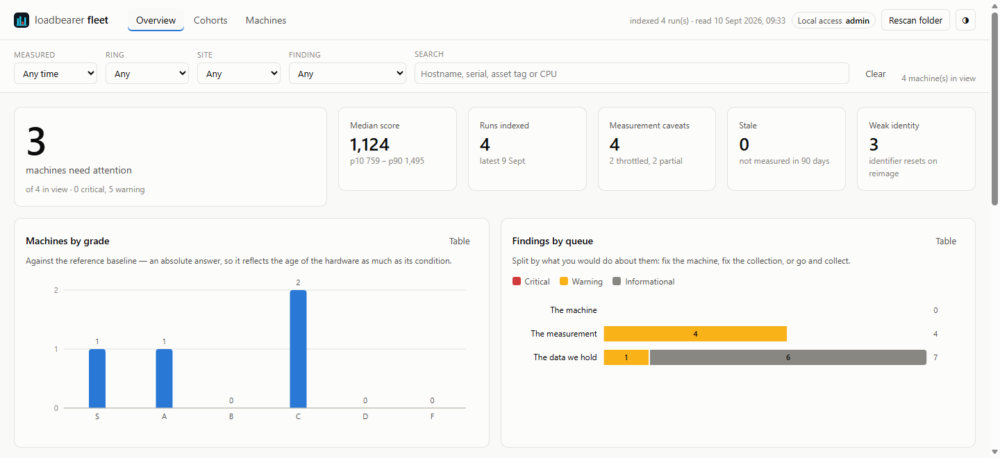

# loadbearer-fleet

[](https://github.com/issinoho/loadbearer-fleet/releases/latest)
[](https://github.com/issinoho/loadbearer-fleet/releases)

[](LICENSE)

A fleet dashboard over collected [loadbearer](https://github.com/issinoho/loadbearer)
results: point it at the folder your deployment tool drops `.json` result files
into, and it indexes them and reports across the estate — executive summary,
grouping, drilldown, and the outliers and red flags worth acting on.

**Status: early but usable.** Ingest, cohort analytics, the red-flag engine, the
web dashboard, comparison, submitting results and single sign-on all work. Out
of the box it runs unauthenticated on loopback; point it at your identity
provider and it does OIDC with roles and per-site scoping. See
[Roadmap](#roadmap).

This file is written to be read start to finish. The
[wiki](https://github.com/issinoho/loadbearer-fleet/wiki) holds what gets
looked *up*: the
[command and configuration reference](https://github.com/issinoho/loadbearer-fleet/wiki/Command-Line-and-Configuration)
(generated from the binary), the
[findings catalogue](https://github.com/issinoho/loadbearer-fleet/wiki/Findings),
the [HTTP API](https://github.com/issinoho/loadbearer-fleet/wiki/HTTP-API),
[metrics](https://github.com/issinoho/loadbearer-fleet/wiki/Metrics), and
[troubleshooting](https://github.com/issinoho/loadbearer-fleet/wiki/Troubleshooting).

**Putting it into production** is two runbooks, ordered, with a command at the
end of each step rather than a paragraph of caveats:
[deploying as a service](https://github.com/issinoho/loadbearer-fleet/wiki/Deploying-as-a-Service)
and
[adding an identity provider](https://github.com/issinoho/loadbearer-fleet/wiki/Adding-an-Identity-Provider).
`service preflight` and `check-auth` do the checking those runbooks would
otherwise ask you to do by hand.

## Getting started

The dashboard reads a folder of result files, so the whole job is: get one
result into one folder, then point this at the folder. No configuration file, no
sign-in, no database to create. Five minutes, and the last step is a browser.

### 1. Collect one result

The results come from [loadbearer](https://github.com/issinoho/loadbearer),
which is a separate tool — install it first.

**Windows** (PowerShell). Its Windows binary *is* Authenticode-signed, so this
part raises none of the warnings [described below](#a-note-on-the-windows-binary):

```powershell
$LB = "1.5.2"   # or whatever is current on the releases page
$zip = "loadbearer-$LB-x86_64-pc-windows-msvc.zip"
Invoke-WebRequest "https://github.com/issinoho/loadbearer/releases/download/v$LB/$zip" -OutFile $zip
Expand-Archive $zip -DestinationPath . -Force
mkdir C:\loadbearer\results
& ".\loadbearer-$LB-x86_64-pc-windows-msvc\loadbearer.exe" `
  run --duration short --output C:\loadbearer\results\$env:COMPUTERNAME.json
```

**Linux** (Ubuntu 22.04 / 24.04 / 26.04):

```bash
sudo add-apt-repository ppa:issinoho/loadbearer
sudo apt install loadbearer
mkdir -p ~/loadbearer/results
loadbearer run --duration short --output ~/loadbearer/results/$(hostname).json
```

`--duration short` is about ten seconds per benchmark, which is enough to see
the dashboard work. Two things worth getting right from the start:

- **`--output` takes a file, not a folder.** Name it after the machine, as
  above, so results from different machines land side by side instead of
  overwriting each other. The dashboard doesn't care what they are called — it
  identifies machines from what is *inside* them — but you will. For one
  machine you are trying this on, that is the whole story; across an estate
  there is a second overwrite to think about, and it is
  [worth two minutes now](#name-the-collected-copy-per-run-not-per-machine)
  rather than after the history you wanted is gone.
- **Standardise on one `--duration` across the estate.** Results are only
  comparable within the same one, which is why the cohort analysis treats it as
  part of a machine's peer group. `normal` is the sensible fleet default;
  `short` is for trying things out.

### 2. Get loadbearer-fleet

Download the archive for your platform from the
[latest release](https://github.com/issinoho/loadbearer-fleet/releases/latest)
and unpack it. There is nothing to install: one binary, no runtime, no
dependencies.

**Windows** — take the `-x86_64-pc-windows-msvc.zip`, unzip it anywhere, then:

```powershell
$V = "0.10.0"
cd "loadbearer-fleet-$V-x86_64-pc-windows-msvc"
.\loadbearer-fleet.exe serve C:\loadbearer\results
```

**Linux** — take the `-x86_64-unknown-linux-gnu.tar.gz`:

```bash
V=0.10.0
A=loadbearer-fleet-$V-x86_64-unknown-linux-gnu
U=https://github.com/issinoho/loadbearer-fleet/releases/download/v$V
curl -LO "$U/$A.tar.gz"
tar xzf "$A.tar.gz"
cd "$A"
./loadbearer-fleet serve ~/loadbearer/results
```

Split across variables so that no line is long enough for a terminal to wrap
it. A wrapped URL pastes as two commands, and the first of them downloads a
truncated path — nine bytes of "Not Found" saved under a plausible filename.

Or build it yourself:

```
cargo install --git https://github.com/issinoho/loadbearer-fleet --locked
```

That needs Rust 1.88 or newer **and a C compiler** — SQLite is compiled from
source and bundled in, which is why there's no database to install. On
Debian/Ubuntu that's `build-essential`; on Windows, the Visual Studio C++ build
tools. Nothing else: TLS is rustls, so there is no OpenSSL to find.

### 3. Open it

```
http://127.0.0.1:8787
```



*The overview, rendered from the four anonymised result files in
`tests/fixtures` — real measurements, identifiers replaced.*

That's it. The overview shows your one machine and its grade against the
reference baseline, and **0 machines need attention** — with nothing to compare
it against, there is nothing yet to say. The reason is filed as an
informational note, under *Show 1 informational* on the overview and on the
**Cohorts** tab: a peer group needs four machines running the same hardware and
the same configuration before its median means anything. Collect a few more and
the comparison that actually matters switches itself on.

### What you get without configuring anything

| | |
| --- | --- |
| Listening on | `127.0.0.1:8787` — loopback only, and it [refuses](#it-will-not-put-the-estate-on-the-wire-in-the-clear) to listen wider without sign-in and TLS |
| Sign-in | None. Everyone who can reach the port is an administrator, and the header says so |
| The index | `fleet-index.db`, in whatever directory you started it from. Derived data — delete it and it rebuilds from the folder ([one caveat](#what-an-index-format-change-does-to-your-history)) |
| Refresh | Rescans the folder every 15 minutes, or when you press **Rescan folder** |

Starting it before you have any results is fine — an empty folder serves an
empty dashboard, and results appear as they land.

### Then, in whatever order suits

- **Point it at the real collection folder** instead of a local one. Anything
  the process can read works, including a UNC path:
  `loadbearer-fleet serve \\fileserver\loadbearer`. Have your deployment tool
  write each machine's `--output` there — see loadbearer's
  [Fleet Deployment](https://github.com/issinoho/loadbearer/wiki/Fleet-Deployment)
  wiki page for the unattended side, including the `--tag` labels this groups by.
- **Label machines with whatever you group them by**, and it becomes a filter
  and a sortable column without being configured here — see
  [Labelling machines](#labelling-machines-and-a-word-about-owners).
- **Run it as a service** so it survives a reboot and rescans on its own —
  see [Running it as a service](#running-it-as-a-service).
- **Turn on single sign-on** before anyone but you can reach it — see
  [Sign-in](#sign-in).
- **Let people submit results through the dashboard** when a machine cannot
  reach the collection folder — see
  [When a machine cannot reach the share](#when-a-machine-cannot-reach-the-share).

### Labelling machines, and a word about owners

Whatever your deployment tool passes as `--tag key=value` is indexed, and the
dashboard works it out from the data rather than from configuration: each key
becomes a **filter** in the row above the views, a **sortable column** in the
machine table and a choice on the **Groups** tab, and any tag *value* is matched
by the Search box. So `--tag site=glasgow --tag ring=canary` needs nothing here
to become two filters, two columns and two ways to group the estate. Tags are deliberately **not** part of a machine's peer group —
relabelling an estate never changes a cohort.

**Owners are the tempting case, and worth a thought first.** `--tag
owner=jsmith` works exactly as above, and one person owning several machines
is just a repeated value. But that value then lives in every result document on
the share, in the index, in `archive_dir` — immutable, and kept — and in every
`backup` snapshot and every file anyone attaches to a bug report. loadbearer's
own `PRIVACY.md` says it plainly: *anything a `--tag` puts in the file is text
you supplied, so don't put personal data in one.* It is also frozen at the
moment of the run, so a reassigned machine keeps its old owner until it is
measured again.

If the assignment already lives somewhere authoritative — Intune's primary
user, SCCM, an asset system — the cheaper answer is to join on it there. This
indexes `serial` and `asset_tag`, which is what those systems key on, and
`report --json` gives you the fleet side to join against. A team label
(`team=finance`) or an asset reference carries most of the same benefit without
putting a person's name in a thousand files.

### A note on the Windows binary

It is **unsigned**, and unlike loadbearer it never gets signed: CI can't reach
the code-signing certificate, and nothing re-signs it by hand afterwards. So on
a clean Windows install expect one of these:

- **SmartScreen** — "Windows protected your PC". *More info → Run anyway*, or
  `Unblock-File .\loadbearer-fleet.exe` before running it.
- **Smart App Control**, on by default on clean Windows 11 installs — blocks
  unsigned binaries outright, with no allow-list or file-hash exception. Build
  from source with the `cargo install` line above, or run it on a machine
  without SAC.
- **WDAC / AppLocker** — add a **file-hash** rule; hash rules permit an
  unsigned binary where publisher rules don't. The exact SHA-256 of the
  executable inside the archive is listed in the release's `SHA256SUMS`, which
  is why it's there.

## How it fits together

```
  PDQ / Intune / Ansible          this
  runs loadbearer on each   ->   \\share\loadbearer\*.json   ->   index   ->   dashboard
  machine, writes --output          (source of truth)          (derived)
                                                                  +
                                                            state file   <-   who acknowledged,
                                                            (not derived)     snoozed, suppressed
```

Three decisions shape everything else:

### When a machine cannot reach the share

That middle arrow is not free, and for some estates it does not exist. Intune
has no pull-file step; a laptop off the corporate network has no line of sight
to a file server; somebody emails you a result from a machine you do not
manage. For those, a result can be submitted **through the dashboard**:

```toml
[server]
collection_dir = '/srv/loadbearer/collection'
upload_dir = '/srv/loadbearer/collection/uploaded'   # must be inside it

[[auth.grants]]
group = "fleet-contributors"
role = "contributor"
```

**Add results** then appears in the header for anyone whose grant allows it,
takes one or more `.json` files, and reports each one: added, already indexed,
or the reason it was refused. Sending the same file twice is safe — ingest is
idempotent by content, so the second answer is "already indexed" rather than a
duplicate.

`upload_dir` has to sit inside the collection folder, and the server refuses to
start otherwise. That is the same decision as everything below: an upload
stored anywhere else would exist only in the index, and this documentation
tells you the index is safe to delete. Inside the folder it is an ordinary
result file that a rebuild finds again.

Anything submitted is checked before it is kept — it must parse as a
`loadbearer.result/1`, it must be under 16 MB, and a contributor whose grant is
scoped to a site may only submit results tagged for that site. The file is
named from the *document*, never from the request. The
[HTTP API](https://github.com/issinoho/loadbearer-fleet/wiki/HTTP-API#submitting-a-result)
page has the whole of it, including `POST /api/upload` for scripting.

**A machine with nobody at it uses an ingest token.** A person uploading
through the dashboard covers the laptop somebody emailed you a result from; it
does not cover a deployment tool running overnight. For that, generate a bearer
credential:

```
loadbearer-fleet token new --name site-glasgow --tag site=glasgow
```

It prints the secret once, for the machines, and an entry for the config that
holds only the secret's SHA-256 — the server never needs the secret itself, so
neither the config nor any backup of it is something anyone can submit with:

```toml
[[ingest.tokens]]
name = "site-glasgow"
token_sha256 = "57be38ae…"
# tags = { site = "glasgow" }   # optional: what it may submit for
# limit_per_minute = 600        # optional: in place of upload_limit_per_minute
# expires = 2027-06-30          # optional: the last day it is accepted
```

A plain `token = "…"` of at least 32 characters still works, for configs that
predate this.

**loadbearer 1.8.0 and later send it themselves.** Deploy the secret once as a
file only administrators can read, then add two switches to the run:

```
loadbearer.exe run --no-gpu --plain --duration short ^
  --output "%ProgramData%\loadbearer\%COMPUTERNAME%.json" ^
  --tag site=glasgow ^
  --upload https://fleet.example.com/api/upload ^
  --upload-token-file "%ProgramData%\loadbearer\fleet-token"
```

The token is read from that file (or `LOADBEARER_UPLOAD_TOKEN`) and never
taken on the command line or in the URL, where process listings, proxy logs
and the deployment tool's history would keep it. The result is posted after
`--output` is written, as the same bytes, so a failed upload — exit `4` —
loses nothing, and a result that also reaches the folder from a share is
stored once. The `--tag` has to match the token's `tags`. See loadbearer's
[Fleet use](https://github.com/issinoho/loadbearer#fleet-use).

Anything else can post one with the same header:

```bash
curl -sS https://fleet.example.com/api/upload \
  -H 'Authorization: Bearer <token>' \
  -H 'Content-Type: application/json' \
  --data-binary @result.json
```

**A token may write and may not read.** It is accepted on the upload endpoint
and nowhere else — every other route wants a session, and none of them so much
as looks at an `Authorization` header — so a credential sitting in a
deployment script cannot be used to enumerate the estate. It is a contributor
and cannot be configured into anything else, its optional `tags` scope it the
same way a grant scopes a person, and revoking it is deleting the entry and
restarting. Past its `expires` date it is refused as expired, which the log
and `loadbearer_fleet_ingest_tokens_refused_total{reason="expired"}` both say,
so a rotation nobody carried out shows up as that rather than as machines that
went quiet. loadbearer sends one only when `--upload` is given, and only to
the URL given: it refuses plain `http://` to anything but loopback and does
not follow redirects, so the token cannot be steered somewhere else.

**And one credential can only write so fast.** `upload_limit_per_minute` (120
by default, zero for none) caps submissions per person and per token, and a
token's own `limit_per_minute` replaces it for that token. One token per site
is one bucket for every machine there, so give it roughly the number that
finish in the same minute, or spread them with loadbearer's `--jitter`. A
refusal is a `429` carrying a `Retry-After` — which is safe to act on, because
ingest is idempotent by content, so a resend of something that did land is
answered `already indexed`. It is a safety valve rather than a defence: what it
stops is a script retrying on a timer somebody misread, or a leaked token
filling the disk 40 KB at a time.

**The folder is the source of truth.** The index is a derived read model, so
deleting it costs a rescan and nothing else — which is why its shape can change
freely and why there is nothing to migrate. That holds only as far as your
collector lets it: the index keeps a row per *run*, so if each machine
overwrites a single file, the index ends up holding history the folder no
longer has, and "derived" quietly stops being true. It is why a format change
renames the index rather than dropping it, why
[`archive_dir`](#backup-restore-and-moving-to-another-server) exists to put
that history back into files, and why the collected copy is worth naming
properly — next.

**The state file is the one thing that is not derived.** What people have said
about the findings — [acknowledged, snoozed,
suppressed](#acknowledge-snooze-suppress) — is in no result document, so it
cannot be rebuilt from the folder, and it is deliberately *not* kept in the
index: that would make deleting the index lose it, and the promise above would
quietly stop being true. It lives in a small SQLite file of its own beside the
index, `fleet-index.state.db` by default (`[server] state` to put it
elsewhere). It is small and changes only when somebody presses a button, but it
is the one file besides the collection folder that has to be [backed
up](#backup-restore-and-moving-to-another-server) — and on a version a release
does not understand, the server refuses to start rather than set it aside and
begin empty.

### Name the collected copy per run, not per machine

The usual deployment recipe writes a fixed path on each machine and copies it
to a share under a fixed name:

```
loadbearer run --output "%ProgramData%\loadbearer\%COMPUTERNAME%.json"
#   then: copy it to \\fileserver\loadbearer\PC-01.json
```

That is two overwrites, and only the first one has to be there.

**The local name must stay fixed.** loadbearer's `--skip-if-newer-than` — the
gate that stops an estate being re-benchmarked every sweep — reads the mtime of
the `--output` file and nothing else, because loadbearer deliberately persists
no state of its own. Put a timestamp in that path and the file never
pre-exists, so the gate never fires and every machine runs every time. Nothing
errors; the flag just stops working.

**The collected name is free.** So put the timestamp there instead:

```
\\fileserver\loadbearer\PC-01\2026-09-10T1147Z.json
```

Filenames mean nothing here — a run is identified by the SHA-256 of its
document, and a machine by what is inside it — so a folder per machine is fine,
and the same run collected twice under two names is still one run. What it buys
is that no result is ever destroyed before this has read it. Without it, a run
survives only if a scan happened to fall between two sweeps; the default
interval is 15 minutes against a sweep measured in days, so it usually does,
but "usually" is not what you want from an audit trail.

Set [`archive_dir`](#backup-restore-and-moving-to-another-server) as well.
The two do different jobs: timestamped names mean nothing is lost *before*
indexing, and the archive means nothing is lost *after* — it survives a
retention policy on the share and a move to another server, at about a fifth of
the raw size.

Then let the share age out. A run this has indexed stays indexed after its file
is deleted (that is what [`forget`](#removing-a-machine--deleting-its-file-is-not-enough)
is for), and a scan re-reads and re-hashes every document it finds, which is
what makes it idempotent — so the total file count, not the folder layout, is
what a scan costs. At a thousand machines reporting weekly, that is ~52,000
files and ~2 GB a year; keeping the share to a recent window and leaving the
long tail to the archive keeps scans quick.

**It reads the schema, not loadbearer's code.** loadbearer's `VERSIONING.md`
makes the `schema`-tagged JSON a stability contract and says in the same breath
that its internal Rust API is not one. So this parses the document. The two
projects release independently and the contract between them is the thing
that's actually promised.

**Data quality is a first-class input, not an afterthought.** loadbearer records
when a run shouldn't be taken at face value — a thermally limited machine, a
measurement taken on battery, a `--target-dir` that turned out to be a RAM disk,
a component a security policy blocked. Ranking an estate while ignoring those
would produce confident nonsense, so they're indexed alongside the numbers and
surfaced.

## Usage

```
loadbearer-fleet scan \\fileserver\loadbearer      # index a folder (or re-index it)
loadbearer-fleet status                            # what's in the index
loadbearer-fleet report                            # summary, cohorts and red flags
loadbearer-fleet report --all                      # include informational and quieted findings
loadbearer-fleet report --json                     # the whole snapshot, as the UI sees it
loadbearer-fleet report --by tag:site              # per site: worst share needing attention first
loadbearer-fleet report --changes 4                # what changed in the last 4 weeks (1, 4 or 13)
loadbearer-fleet report --lifecycle                # what to replace, repair or investigate, and why
loadbearer-fleet report --distribution disk        # how one measure is spread, one configuration at a time
loadbearer-fleet report --heatmap                  # every machine against every component
loadbearer-fleet serve \\fileserver\loadbearer     # the dashboard, on http://127.0.0.1:8787
loadbearer-fleet init-config > fleet.toml          # a starter config, placeholders included
loadbearer-fleet serve --config fleet.toml         # with single sign-on
loadbearer-fleet check-auth --config fleet.toml    # check the identity provider settings
loadbearer-fleet notify test --config fleet.toml   # send a test event to the [notify] webhook
loadbearer-fleet backup fleet-2026-09-10.db        # consistent snapshot of the index and state file
loadbearer-fleet forget PC-01                      # remove a decommissioned machine, and its triage
```

Those are the ones worth knowing by heart. For the rest — every command, every
option, every configuration key — see
[Command line and configuration](https://github.com/issinoho/loadbearer-fleet/wiki/Command-Line-and-Configuration)
in the wiki, or `--help`, or `loadbearer-fleet reference` to print that same
page from the binary you are actually holding. The wiki page *is* that output,
so it cannot describe a flag that does not exist.

Rescanning is cheap and idempotent: every run is keyed by the SHA-256 of the
document it came from, so an unchanged file is a no-op and a file the collector
renamed on copy doesn't become a second run.

## Identity, and why grouping is trustworthy

Runs are attributed to a machine by the best identifier the result carries:

| | survives a reimage | notes |
| --- | --- | --- |
| `serial` | yes | what asset, warranty and lease records key on |
| `smbios_uuid` | yes | absent on some VMs |
| `machine_id` | **no** | always readable; resets on reimage |
| `hostname` | no | renameable and reissued — a last resort |

This matters in practice and not just in theory: on Windows all four are
readable by any user, but on Linux the DMI serial and UUID are root-only, so an
unprivileged sweep there keys on `machine_id`. In testing against seven real
machines, three keyed on `serial` and four on `machine_id`. The dashboard
reports which, because "four of your machines are keyed on an identifier that
resets when they're reimaged" is something an estate owner should know.

## Roadmap

- [x] Schema reader, tolerant of older files and forward-compatible with new fields
- [x] Folder scan into a SQLite index, idempotent by content, full history retained
- [x] Cohort analytics — compare a machine against its own peer group, and against
      its own history, rather than against the reference baseline
- [x] Red flags: low grades, cohort outliers, regressions, weak components, thermal
      limits, forced runs, partial runs, RAM-backed disk targets, battery wear,
      stale results, weak identity
- [x] Drive health, nearly full disks and out-of-date firmware, from what
      loadbearer 1.6.0 already records — see [Drives, free space and
      firmware](#drives-free-space-and-firmware)
- [x] Web UI: executive summary, cohort explorer, groups, machine table, machine drilldown
      with history — see [The dashboard](#the-dashboard)
- [x] Entra ID / OIDC SSO with PKCE, roles from group claims, tag-scoped
      authorization — see [Sign-in](#sign-in)
- [x] Service packaging, config file, metrics — see [Running it as a service](#running-it-as-a-service)
- [x] Backup, restore and moving between instances — see [Backup, restore, and
      moving to another server](#backup-restore-and-moving-to-another-server)
- [x] Compare two to four runs head to head, from raw metrics rather than
      scores, on the dashboard and at a prompt
- [x] Submitting results through the dashboard and over the API, with ingest
      tokens for machines nobody is sitting at — see [When a machine cannot
      reach the share](#when-a-machine-cannot-reach-the-share)
- [x] The fleet over time — what changed in the last week, month or quarter,
      and the estate's figures week by week, reconstructed from the runs
      already indexed — see [What changed, and the fleet over
      time](#what-changed-and-the-fleet-over-time)
- [x] Acknowledge, snooze and suppress findings, kept in a state file of its
      own so the index stays disposable — see [Acknowledge, snooze,
      suppress](#acknowledge-snooze-suppress)
- [x] A webhook when a scan finds a new critical finding, and a daily or weekly
      digest — one generic, signed JSON POST, off unless configured — see
      [Notifications](#notifications)
- [x] Every threshold set from the configuration file, and different lines for
      some machines by tag, system model or CPU model, named on each machine
      they change — see [Thresholds, and different lines for some
      machines](#thresholds-and-different-lines-for-some-machines)
- [x] How each component and subtest is spread across the estate, drawn only
      from runs measured the same way, and every machine against every
      component — see [How each component is spread, and which machines are
      weak where](#how-each-component-is-spread-and-which-machines-are-weak-where)

## Analysis

### Peers first, then history, then the baseline

The reference baseline answers "is this machine any good". It is the wrong tool
for "is this machine broken": loadbearer's own baseline header puts ±10–20%
uncertainty on the anchors, and some of them rest on three machines. A 15%
shortfall against the baseline could be the baseline.

So the primary comparison is **a machine against its peers**, and the secondary
one is **a machine against its own history** — which is stronger still, because
the hardware is held constant. A machine 15% down on forty identical machines in
the same estate, or 15% down on its own last four runs, is the machine.

A cohort is not "machines with the same CPU" but machines with the same CPU
*measured the same way*: `build_isa`, `duration_preset`, `profile` and `baseline`
each change the number without anything changing about the machine, so each is
part of the cohort key. Installed RAM deliberately is not — two machines with the
same CPU and different DIMM configurations really do differ, and surfacing the
single-channel one is the point rather than something to excuse.

Cohorts use **median and median absolute deviation**, not mean and standard
deviation, because the statistic has to survive the thing it is looking for. Six
machines at 1000 and two at 720 have a mean of 930 and a standard deviation of
118, which puts the two bad ones 1.8 sigma out — invisible to a 3.5-sigma rule,
because each one's damage is partly absorbed into the spread the other is
measured against. The median stays at 1000 and names both. On a fleet of clones
MAD collapses towards zero, so the dispersion is floored at a fraction of the
median; that floor is usually what binds, and it puts the effective trigger at
around a 15% shortfall.

### Three queues, not one wall of red

Findings are separated by what you would do about them, because mixing them
means an estate owner reads a thermal caveat as a failing asset:

| Queue | Means | Examples |
| --- | --- | --- |
| **machine** | a hardware decision — repair, replace, reassign | low grade, cohort outlier, regression, one weak component, worn battery, failing or worn drive, media errors, nearly full disk, firmware behind its peers or simply old |
| **measurement** | the number can't be trusted until collection is fixed | thermally limited, run on battery, held back by its power settings, partial run, RAM-backed disk target, unstable CPU timings |
| **coverage** | about the data we hold, not about the machine | stale result, attributed by hostname only, no peer group |

Every threshold lives in one struct with its reasoning attached, and every one
can be set in the configuration file — see [below](#thresholds-and-different-lines-for-some-machines).
Every rule and what fires each one are in
[Findings](https://github.com/issinoho/loadbearer-fleet/wiki/Findings).

### Thresholds, and different lines for some machines

Every number a rule turns on is a threshold, and each can be set in
`[thresholds]` in the configuration file. One left unset keeps its default, so
a file without the section judges the fleet exactly as this README describes.

| Threshold | Default | What it is | Per machine |
| --- | --- | --- | --- |
| `min_cohort` | 4 | How many machines a cohort needs before a member is compared with its median. At least 3: with two, each is exactly as far from their median as the other, so neither can ever stand out. | no |
| `cohort_z` | 3.5 | The modified z-score, from the median and MAD, at which a member is an outlier. | no |
| `cohort_min_shortfall` | 0.10 | A shortfall against the cohort median smaller than this is never named, however unusual it is. | no |
| `mad_floor_frac` | 0.03 | The cohort's spread is floored at this fraction of its median. On a cohort of clones, this is what binds. | no |
| `regression_frac` | 0.15 | A drop against the median of the machine's own earlier comparable runs that counts as a regression. | yes |
| `stale_days` | 90 | After this many days a machine's latest result is stale — history rather than inventory. | yes |
| `battery_health_pct` | 70 | Battery capacity, as a percentage of design, below which the battery is worn. | yes |
| `unstable_cpu_subtests` | 2 | Low-confidence CPU subtests at which a run is too shaky to read. | yes |
| `drive_wear_pct` | 80 | Rated endurance used, as a percentage, at which a drive is worn. 100 is critical whatever this says. | yes |
| `drive_spare_pct` | 20 | Spare blocks left, as a percentage, below which a drive is worn. | yes |
| `disk_free_pct` | 10 | Free space on the fullest fixed volume, as a percentage, below which the disk is nearly full. | yes |
| `disk_free_critical_pct` | 5 | Below this, nearly full is critical. Never above `disk_free_pct`. | yes |
| `firmware_behind_days` | 90 | How far behind the newest firmware seen on the same system model a machine's has to be before it is named. | yes |
| `firmware_old_years` | 4 | Firmware older than this when the machine was measured is named even with no peer to compare against. | yes |
| `replace_age_years` | 5 | From this best-estimate age a machine is old, for the [lifecycle verdict](#what-to-do-about-each-machine). | yes |

Each value is checked when the file is loaded, and a bad one stops the start
with a message naming it: a percentage from 0 to 100, a fraction above 0 and
below 1, days, years and the z-score above zero, a count a whole number of at
least 1 (`min_cohort` at least 3), and `disk_free_critical_pct` never above
`disk_free_pct`. An unknown key is refused, as everywhere in the file.

**Different lines for some machines.** A lab measured once a year is not stale
at ninety days, and a kiosk with a small fixed image runs mostly full by
design. Loosening the line for everybody hides the machines that are stale or
full by accident; leaving it means the same known findings in the queue for
ever. So an override sets some thresholds for the machines it picks:

```toml
[thresholds]
stale_days = 120

[[thresholds.overrides]]
name = "lab machines"
tags = { site = "lab" }
stale_days = 365

[[thresholds.overrides]]
name = "kiosks"
system_model = "HP t640 Thin Client"
disk_free_pct = 5
disk_free_critical_pct = 2
```

A rule picks machines by `tags` — every one given must be among the machine's
tags, matched exactly as a grant's or a suppression's are — and by
`system_model` and `cpu_model`, exactly as the machine reports them: the same
values the Groups view groups by, so `"Dell Inc. Latitude 7440"` does not pick
a Latitude 7440 2-in-1. Everything given must match. A rule has to give at
least one of the three, and an empty `tags` table is refused: values for the
whole fleet belong in `[thresholds]` itself. `name` is what people see; unset,
the rule is named after what it picks (`site=lab`), and no two rules may share
a name.

**First match wins, threshold by threshold.** For each threshold, a machine
takes the value from the first rule in the file that picks it and sets that
threshold; otherwise `[thresholds]`; otherwise the default. A later rule still
supplies a threshold an earlier one left alone. Above, every machine is stale
after 120 days except the lab's, after 365, and a kiosk in the lab takes 365
days from the first rule and 5% from the second. A rule that can never change
anything, because earlier rules picking every machine it picks already set
everything it sets, is reported in the log at startup. The two disk lines are
checked together for every pairing a machine could end up with — one rule's
critical line against another's, or the fleet's, nearly-full line — and a
pairing with critical above nearly full is refused.

**Only the lines that judge one machine.** The four cohort thresholds are
fleet-wide only, and an override that sets one is refused at startup. Whether
a cohort is big enough, how spread it is and where in that spread an outlier
starts describe one calculation over every identical machine in the index, and
a value for some of them would be a different calculation over the same
cohort. Every other threshold judges one machine against a fixed line, so a
different line for some machines changes what is said about those machines
and nothing else. `firmware_behind_days` compares a machine with its peers,
but the newest firmware on a model is worked out across the estate without
reference to any threshold, so a machine's own line moves only what is said
about that machine.

**Visible, not silent.** A machine with 8% free and no finding has to be told
apart from one nobody looked at. So each machine's page says which rules
changed how it was judged, and what they set — *Judged by: kiosks: disk nearly
full under 5% free, critical under 2% free* — and the findings quote the line
they were drawn against. Where the dashboard quotes a fleet-wide value — the
Overview's stale tile, the lifecycle rule and its age line — it says how many
machines in view are on a line of their own. `report` counts the machines an
override judged and names the rules, and `report --lifecycle` names the rule
beside each machine it applies to. In the API, the snapshot carries the
fleet-wide `thresholds` and the rules as `threshold_overrides`, and each
machine carries `overridden_by`: the rules that changed it, each with the
thresholds it supplied — only those, so a threshold an earlier rule supplied
first is not listed against a later one.

**A threshold is configuration, not history.** Changing one, or adding a rule,
re-judges the past as well as the present: [the history is
reconstructed](#what-changed-and-the-fleet-over-time) with today's lines, as
it is with today's rules. In each past week a rule picks a machine by the tags
and models of the run that stood for it then, so a laptop that has since left
the lab was judged as a lab machine while it was there. The file is read at
startup, so a change needs a restart. A finding a change makes go away is
resolved like any other: an acknowledgement or snooze of it is spent when the
server starts, and the finding is listed as resolved in "What changed".
Notifications compare one rebuild with the one before, and the first after a
restart is already judged by the new lines, so a finding a change makes
critical is not sent as news; it is in the next digest.

### Acknowledge, snooze, suppress

A finding nobody can mark as seen is a finding read every morning. So each one
can be quieted, three ways:

| | Means | Lasts until |
| --- | --- | --- |
| **Acknowledge** | Seen, in hand. Records who, when, the severity it had, and an optional note. | The finding goes away — then it is spent, so the same rule firing on the same machine months later is news again — or it gets *more severe* than it was when acknowledged. |
| **Snooze** | Not now. The same, with a date: a week, a month or three months from the dashboard, any day up to a year over the API. | That day (UTC), by the clock — no rescan or restart needed — or the finding getting more severe, whichever is first. |
| **Suppress** | Not news here, by rule: one finding code on one machine, on every machine carrying a set of tags, or across the whole fleet. Records who, when and a note. | Somebody removes the rule. It does not lapse when the finding gets worse — that is what makes it a rule rather than an acknowledgement. |

If more than one applies, a suppression wins over a snooze, and a snooze over
an acknowledgement (a finding has at most one of the last two — the latest word
replaces the one before). A finding is "the same finding" if it is the same
rule on the same machine, as everywhere else in this tool; the one rule that can
raise more than one finding per machine, a weak component, is quieted as one,
by the worst of them.

**It is an attention layer, not a change to the rules.** A quieted finding is
still computed, still in the snapshot and in `report --json` with what was
said about it in its `triage` field, and still drives the
[lifecycle](#what-to-do-about-each-machine) verdict; "What changed" and the
history are judged by the rules and ignore it entirely. What changes is
whether it *needs attention*: the headline, the critical and warning counts,
each group's flagged count and the queue all leave it out, and say beside
themselves how many were quieted — "3 acknowledged · 1 snoozed · 12
suppressed". The queue hides snoozed and suppressed findings until asked,
and shows acknowledged ones quieter, after the live ones; a machine's own page
shows every finding with what was said about it. The `flag=` filter still
finds a machine whether or not its finding is quieted, because "which machines
have this" is a question about the machines.

**Who may.** A viewer sees it. A contributor or admin may acknowledge, snooze
or undo either on the machines in their scope. Only an admin may create or
remove a suppression, because a rule by tag or across the fleet reaches past
any one scope. On the dashboard, an admin suppresses for one machine or the
whole fleet; a rule by tags is API-only in this release (`POST
/api/suppressions` with `tags`). Every change is logged with who made it.

**How an acknowledgement ends.** Each time the snapshot is rebuilt — after a
scan, an upload or a change by another process — an acknowledgement or snooze
whose finding is no longer raised on a machine that is still in the index is
dropped, as is one whose finding has got worse or whose snooze has run out,
and the log says which and why. A machine missing from the index altogether
keeps its marks, so an index rebuilt by an upgrade, which is empty until its
first scan, does not wipe them. The judgement is made at those rebuilds, so a
finding resolved and back again between two of them was never seen resolved
and its acknowledgement stands. A finding that goes away because a
[threshold](#thresholds-and-different-lines-for-some-machines) was changed is
resolved the same way: the server reads thresholds when it starts, and the
mark is spent then.

It is all kept in the [state file](#how-it-fits-together), never the index.
`report` reads it and shows what a running server would — live findings
listed, quieted ones counted on a line, `--all` listing them with who said
what — without writing to it.

### Head to head, when the estate view isn't the question

Cohorts answer "is this machine normal for its kind". Sometimes the question is
narrower — *this* laptop against *that* one, or against itself before a
firmware update — and that is the **Compare** tab, or at a prompt:

```bash
loadbearer-fleet compare FLEET-WIN-01 FLEET-LNX-01
```

Every subtest the runs share gets a ratio to the first, adjusted for which way
the metric runs, rolled up by geometric mean per component and overall. It
reads **raw metrics rather than scores**, so it does not depend on the baseline
or the curve anything was graded against: two machines measured eight months
apart still compare, and recalibrating the baseline does not move the answer.

Most of the care is in what it declines to do, because each of these would
produce a confident number that means nothing:

- **No direction, no ratio.** A metric only has a better and a worse if you
  know which way it runs. Runs indexed before 0.5.3 have no direction recorded;
  `scan --reindex` fills them in from the documents you already hold.
- **A peak is not a median.** loadbearer 1.5.0 added peak reporting, so an
  estate can hold both. Comparing one against the other measures the statistic
  rather than the machine.
- **Network and GPU are shown and not counted.** They depend on the host, its
  drivers and whatever the network is doing — the same reason they stay out of
  a grade. A verdict that counted them would contradict the scores beside it.

And it says how much it rests on. A comparison can honestly end up using two of
thirty measurements, and that should not read like one built on all thirty — so
the count travels with the result and the verdict leads with the caveat when
the basis is thin. The full shape, JSON included, is in
[HTTP API](https://github.com/issinoho/loadbearer-fleet/wiki/HTTP-API#comparing-runs).

### How old a machine is

Usually the first question about an estate, and nothing on a PC records the
answer. What does carry a date is the CPU: every generation has a launch, and
a machine can't be older than its CPU. So the **Age** on a machine page —
`≤ 3.8 yr — built Jan 2023 or later` — is an upper bound, counted to today
rather than to the last run, and the machine table sorts by it.

Where loadbearer judged the firmware to be as shipped, its date places the
machine more closely, and the lifecycle verdict uses that instead — so a
machine's **best-estimate age** is worded as one or the other: "at most 6.2
years old" from the CPU, "about 4.1 years old" from the firmware. A firmware
date earlier than the CPU's launch is the firmware being wrong, and the bound
stands. See [What to do about each machine](#what-to-do-about-each-machine).

loadbearer 1.6.0 and later record the evidence with each run: the CPU's
launch, the firmware's date and whether it's probably what the machine
shipped with, and the boot drive's power-on hours and wear. Older runs record
none of it, so the launch is derived here from the CPU model instead, and the
page says so ("from the CPU model"). What only the machine itself can read —
the firmware, the drive — stays empty for those rather than guessed. A CPU the
launch table doesn't know, such as a Xeon, shows no age at all.

Drive hours are kept as the drive reports them, with one caveat surfaced:
some SATA SSDs stop counting while idle, so a drive that averages minutes per
power cycle is marked **likely undercounted** — its hours measure time spent
working, not time in service.

### What power the run had

loadbearer 1.7.0 and later record whether a run was on mains or battery and
the power settings in force: on Windows the plan and the power mode for the
source it was on (Best power efficiency / Balanced / Best performance), on
Linux the platform profile. The machine page and a comparison show it as
**Power**. A run taken on battery is flagged whether or not the collector asked
for loadbearer's mains gate, and one whose settings held it back — energy
saver, Best power efficiency, a capped processor state, a low-power profile —
is flagged **held back by its power settings**; a drop in score on such a run
is reported as a warning to re-measure rather than a critical regression.
Older runs record none of it.

### Drives, free space and firmware

loadbearer 1.6.0 and later, run with admin or root, record health counters for
every drive they can query, and the firmware's version and date. The machine
page lists the drives — hours, wear, spare, media errors and the drive's own
warning — and six findings in the **machine** queue read them:

- **A drive reporting a critical warning** is critical: that is the drive
  itself saying it is in trouble (spare exhausted, overheating, reliability
  degraded, gone read-only), not an inference from a slow run. Back it up and
  replace it.
- **Media errors** — reads the drive could not correct — are a warning from
  the first one.
- **A worn drive** is a warning at 80% of its rated endurance used, or below
  20% spare, and critical at 100%. The endurance figure is the vendor's
  estimate, not a failure prediction, and can pass 100. A drive that reports
  no wear figure — most hard disks, some SATA SSDs — is never guessed at.
- **A nearly full disk** — the fixed volume with the least free space, as a
  share of its size — is a warning under 10% free and critical under 5%.
  Percentage rather than bytes on purpose: an SSD slows as it fills whatever
  its size. Removable media and volumes under 8 GiB (EFI and recovery
  partitions, loop mounts) are left out; this one reads `machine.disks`, so
  it works on results from any version.
- **Firmware behind its peers** is informational: among machines of the same
  system model, one whose BIOS is at least 90 days older than the newest seen
  on that model. It names both versions and dates, so it reads as "this
  update exists and other machines here already have it". Like a cohort
  median, the newest firmware is worked out across the whole estate rather
  than the filtered view. Where there is no peer to compare against,
  **old firmware** — more than four years older than the run — is named
  instead.

Every line above is a threshold the configuration can change, for the whole
fleet or for some machines — see [Thresholds, and different lines for some
machines](#thresholds-and-different-lines-for-some-machines). Every drive is
judged, not just the boot drive, with one finding per rule per machine naming
the worst. Unsafe-shutdown counts are recorded and shown but
never flagged: a healthy laptop collects hundreds from lid closes and flat
batteries. An index from an earlier version gains all of this on open, empty
for the runs it already holds — `scan --reindex` fills them in from the
documents.

## The dashboard

```
loadbearer-fleet serve \\fileserver\loadbearer
```

Scans the folder, then serves seven views on `127.0.0.1:8787`: an executive
**overview** (how many machines need attention, what changed since a week, a
month or a quarter ago, grade distribution, findings by queue, score spread,
the ranked list of what to look at, and the same figures week by week over
the last half-year), a **cohort
explorer** (each machine against the median of the machines like it), **groups**
(the estate by site, system model, CPU, OS or any tag), **components** (how
one measure is spread across the estate, and every machine against every
component), **lifecycle** (what
each machine calls for — replace, repair, investigate, watch or keep — and
why), a sortable **machine table**, and a **drilldown** per machine with its
score history, its components, its findings in full, its drives, every
subtest of its latest run, and — where a [threshold
override](#thresholds-and-different-lines-for-some-machines) applies — the
lines it was judged against instead. On a phone the seven tabs scroll sideways inside
their strip, with the current one kept in view and a fade on the edge where
more are hidden.

### Which site is in the worst shape

The tempting answer is the median score per site, and it mostly measures how
old each site's hardware is: the site refreshed last year wins whatever state
its machines are in. So the **Groups** tab compares groups by the median of
their members' standing *against identical machines* — each machine against the
cohort median of the same CPU measured the same way, worked out across the
whole index. A site whose machines run 12% below the same hardware elsewhere is
pointing at something about the site — power policy, the image, dust, a bad
batch — rather than at its purchase dates. Score and grade mix are shown beside
it, as description.

A group drawn from fewer than four machines with a peer group is marked
**thin** and left out of that chart, with a note saying how many and why — the
same reason a cohort that small is not compared against. The other charts show
the *share* of each group needing attention and its grade mix, so a big group
does not look worst for being big. Machines with no value — untagged, or no
system model recorded — are a group of their own, so the groups always add up
to the machines in view, and the filter row applies as it does everywhere
else. Clicking a group opens the machine table filtered to it. The table also
counts each group's machines to **replace** and to **repair** — the two
lifecycle decisions that cost money, so "which site needs budget" is a sort —
and clicking either count opens just those machines.

`report --by <dimension>` prints the same thing at a prompt — `model`, `cpu`,
`os`, or `tag:<key>` — and `--json` gives the document the dashboard draws.

### How each component is spread, and which machines are weak where

The other views read the fleet by its overall score. The **Components** tab
asks the questions underneath it: how storage, or one particular subtest, is
spread across the estate, and which machines are weak in which component.

**A distribution of one measure.** Pick the overall score, a component, or a
single subtest — the picker lists each component with its subtests, and how
many machines in view have each — and the tab draws a histogram of the
machines in view, with the median and the p10 and p90 marked. Choosing a bar
lists the machines in it; with none chosen, the lowest and highest few are
listed, so both ends are a click from their pages. A split by site, model,
CPU, OS or any tag draws each group's p10-to-p90 range and median on the same
axis, leaving out groups of fewer than four machines, as Groups does.

What it will put on one axis is the point of it:

- **One configuration at a time.** A number is only comparable with another
  measured the same way — the same preset, profile, baseline and instruction
  set, the rule [cohorts](#peers-first-then-history-then-the-baseline) follow
  — so the distribution draws the configuration with the most machines, says
  which, and offers the others with how many machines each.
- **A score is a score, a subtest is its measurement.** The overall and a
  component are drawn as the score against the baseline. A subtest is drawn
  as its raw value in its own unit, as [Compare](#head-to-head-when-the-estate-view-isnt-the-question)
  reads it: not every subtest is scored, and the raw figure is what was
  measured. Within the configuration a subtest also has to be in the same
  unit and the same statistic — a peak beside a median measures the
  statistic, not the machine.
- **Nothing left out silently.** Every machine in view is either drawn or
  counted out with its reason: no such measurement in its latest run,
  another configuration, another unit, another statistic.
- **Direction is said, not assumed.** A score is higher-is-better. A subtest
  says which way it runs where the runs recorded it; where they did not —
  runs indexed before 0.5.3, until `scan --reindex` — the view says it cannot
  tell which end is better rather than implying one. Network and GPU, and
  informational subtests, are drawn and marked as never part of a grade.

It describes the estate as measured: throttled, partial and on-battery runs
are drawn like any other, and the findings say which to doubt. It does not
rank machines across hardware — most of a raw spread across different CPUs
is the CPUs — which is what the grid below is for.

**Every machine against every component.** Below the distribution, a grid:
one row per machine, one column per component the result grades — CPU, memory and disk in a
current result. Each cell is the component **against the same
component on identical machines**: the difference from the median of that
component across the machines with the same CPU measured the same way,
worked out across the whole index exactly as a cohort's median is. It is the
per-component form of the comparison Groups headlines with, for the same
reason: a raw disk score across different laptops mostly measures the
laptops. The cells step at 5%, 15% and 25% either side of a neutral middle —
within 5% is run-to-run noise, 15% is about where a cohort outlier is named,
25% where it is critical — in the dashboard's validated blue and red, and
every cell carries its figure as text. A machine whose cohort has fewer than
`min_cohort` (four by default) measurements of a component has **no peers** there, and the cell says
so and is left uncoloured rather than shown as average. A button switches to
each component's grade and score against the reference baseline instead,
which says how new the hardware is as much as how it is doing; grades are
not coloured, as everywhere on the dashboard.

A cell marked **weak** is the [weak component](#what-to-do-about-each-machine)
finding — graded D or F and at least two grades below the machine's own —
read from the same rule the finding is raised by, in either view, so a cell
never looks fine on a machine carrying that finding. That rule reads no
threshold, so no [override](#thresholds-and-different-lines-for-some-machines)
moves it. A cell well below its peers without the mark is the other
comparison: slower than the same part elsewhere, rather than weak against
the rest of its own machine.

The grid sorts by machine, by the overall standing or by any component, the
weakest first, and a row opens the machine. It holds at most **200 rows**,
after sorting, and says when there are more — "showing 200 of 1,340, filter
to narrow" — so the filter row is how a large estate is read. The measure,
configuration, split, chosen bin, sort and encoding are all in the URL, so a
view can be linked.

Both are projected through the filter and the sign-in scope like everything
else, so every count, bin edge and "left out" figure is made of the machines
in view; only the cohort medians behind the cells are drawn from the whole
index, as they are everywhere. `report --distribution <measure>` and
`report --heatmap` print the same at a prompt, and `--json` the documents
the tab draws.

### What to do about each machine

Findings say what is wrong with a machine; the decision that follows is a
different question, and the answers differ in kind and in cost. The
**Lifecycle** tab gives every machine one of five verdicts, from a short rule
over evidence the dashboard already has — never a score — with the reasons
that fired it written out:

| Verdict | When (first match wins) |
| --- | --- |
| **Replace** | Graded **F**; or **old** and either graded D or F or with a **part problem** |
| **Repair** | A part problem on a machine that is neither: a part, not the platform |
| **Investigate** | Slower than identical machines, or than its own earlier runs |
| **Watch** | Old, or graded D |
| **Keep** | None of the above |

- **Old** is at least five years (`replace_age_years`, which the configuration
  can change for the whole fleet or for some machines — see
  [Thresholds](#thresholds-and-different-lines-for-some-machines)) by the
  machine's best-estimate age — the upper bound from its CPU, or the dating
  from original firmware where there is one (see [How old a machine is](#how-old-a-machine-is)). The reason says
  which: "At most 6.2 years old, by its CPU's launch date" or "About 4.1 years
  old, by its original firmware's date". A machine with no age evidence is
  never old; it is not guessed.
- **A part problem** is a worn battery, a drive raising its own critical
  warning, media errors or a worn drive, or one component graded well below
  the rest. Not a nearly full disk, which is housekeeping, and not firmware.
- **Slower than identical machines or its own past** is the cohort and
  regression findings: it should be faster than it is, and finding out why
  costs less than buying.

Two consequences are deliberate. **Age alone is not a reason to buy**: an old
machine that still performs and whose parts are sound is *watch*, not
*replace*. And **an F is against the reference baseline**, so *replace* for a
grade means "inadequate against that reference" — an estate with modest needs
may reasonably disagree, and the reason says "Graded F against the reference
baseline" so nobody mistakes it for a fault.

A verdict that rests on a performance figure — the grade, one component graded
far below the rest, or being slower than its peers or its past — is marked **re-measure first** when the same run was
throttled, on battery, held back by its power settings, incomplete or measured
against a RAM-backed disk: the measurement condemning the machine may be what
is wrong. One resting only on age and on parts that report their own condition
is not, since no measurement caveat changes a worn battery or a drive's own
counters.

The tab opens with a tile per verdict — choosing one lists those machines —
then **Age against score**, one mark per machine at its best-estimate age:
replace in the critical colour as squares, repair in the warning colour as
triangles, the rest gray circles, with a line at five years. Hollow marks are
upper bounds (the machine sits on or left of its mark), filled ones are
dated, and machines with no age estimate are counted beside the chart rather
than placed. Below is the list, most urgent first: decision, reasons, age,
grade, score, battery health, worst drive wear, system model and tags. Each
machine's page states its verdict too, and the Overview counts the machines
to replace.

`report --lifecycle` prints the replace, repair and investigate lists with
their reasons (`--all` adds the machines to watch), and `--json` the counts
and every machine that is not *keep*. The five-year line is
`replace_age_years` in the `thresholds` every snapshot carries; a machine an
override gives another age names that rule in its `overridden_by`.

### What changed, and the fleet over time

Every other figure on the dashboard describes the fleet *now*. The overview
also says what changed — since a week, four weeks or thirteen weeks ago, chosen
on the card and kept in the URL — and charts the estate week by week over the
last half-year: how many machines needed attention and how many of those were
critical, the median score, and the fleet's size and grade mix.

"What changed" compares two dates finding by finding, a finding being the same
rule on the same machine: findings that are **new**, **worse** (warning to
critical, say), **resolved** or **eased**; machines **added** since, whose
findings are listed apart because a machine new to the fleet is news of a
different kind; and machines whose **grade** moved. The headline counts
critical and warning changes, with informational ones beside them rather than
in them — a dozen machines going stale is real, and is not the same news as one
drive failing. When nothing in view had been measured that far back, it says so
rather than reporting the whole fleet as new.

**None of this is recorded as it happens; it is reconstructed.** The index
already keeps every run with the time it was taken, so the fleet as it was
known at any date can be worked out again: each machine as of its latest run
by then, judged with that date as "today", against only the runs it had by
then. That has real advantages — an index that has been collecting for a year
has a year of history the first time this version opens it, a rebuilt index
rebuilds its past with it, there is no schema change, and the past is judged
by *today's* rules, so a line that moves moved because the fleet did rather
than because a threshold was tuned — and some consequences worth knowing:

- **A machine you `forget` leaves the past too**, not just the present.
- **A result collected late changes the past.** A run taken a month ago and
  ingested today appears a month ago — it is dated when the machine was
  measured, not when the server heard — so a past week's figures can move
  after the week is over.
- **Old runs only know what was indexed from them.** A field a later version
  of this tool reads (drive health, for one) is empty on runs indexed before
  it until `scan --reindex`, so a drive finding cannot appear in a week before
  the drive data does.
- **Thresholds are today's too.** A threshold changed, or an override added,
  re-judges every week. Which override picks a machine in a past week depends
  on the tags and models of the run that stood for it then — what it was
  judged as is what it was — while which week it is *shown* in follows its
  tags now, as below.
- **A machine is shown under the tags it carries now**, in every week — the
  history is projected onto your current view, so the filter and your sign-in
  scope apply exactly as they do everywhere else, and a machine that moved
  from one site to another brings its history with it, as its drilldown
  already does.
- **A run dated in the future, or with a timestamp that cannot be read**, is
  in today's view as it always was, but cannot be placed in the past — so
  until its date arrives it counts as newly added.

The server keeps the last 26 weeks, rebuilt with the snapshot whenever the
index changes, so reading them costs nothing extra. As a guide to size: at
2,000 machines with eight runs each it takes about 0.3 s on top of the
snapshot and holds about 5 MB.

`report --changes [WEEKS]` prints the same comparison at a prompt — 1, 4 or 13
weeks, a week if no number is given — with `--all` to list informational
changes too and `--json` for the document the dashboard draws.

`POST /api/rescan` — the Rescan button — re-reads the folder. `GET /api/snapshot`
returns exactly what the dashboard draws, so any view can be scripted or
diffed; `GET /api/groups?by=<dimension>` is the Groups tab, taking the same
filter parameters; `GET /api/changes?window=1|4|13` and
`GET /api/timeline?weeks=4…26` are the overview's "What changed" and its
charts, taking the same filter parameters too;
`GET /api/distribution?measure=overall|<component>|<component>/<subtest>&config=<key>&split=<dimension>`
and `GET /api/heatmap?encoding=cohort|grade&sort=host|overall|<component>&dir=asc|desc`
are the Components tab, taking the same filter parameters, an unknown
measure, configuration, dimension, encoding or sort refused with a 400 that
names what there is — judged against the caller's own view, so it names
nothing they cannot see; and `GET /api/machine/{key}` is the drilldown payload.
The snapshot carries the fleet-wide `thresholds` and the configured
`threshold_overrides`, and each machine, there and in the drilldown, its
`overridden_by`.
`POST /api/triage` (`{ machine_key, code, action: "acknowledge" | "snooze" |
"clear", until?, note? }`) acknowledges, snoozes or clears one finding;
`GET /api/suppressions` lists the suppression rules the caller may see, and an
admin makes and removes them with `POST /api/suppressions` (`{ code,
machine_key? | tags?, note? }`) and `DELETE /api/suppressions/{id}`. A
scoped caller is shown only the rules that say nothing about machines outside
their scope: fleet-wide rules, rules for machines they can see, and tag rules
that pick out one of their machines or sit wholly within their scope. Each
finding in every response carries `triage` — null while live — and the
summary and groups carry `quieted` counts; there is no `triage=` filter,
since the client already has each finding's state. The lifecycle
verdicts ride in the snapshot and the drilldown — each machine's `lifecycle`
and `age_estimate`, and the counts in `summary.lifecycle` — so there is no
endpoint of its own; `lifecycle=replace|repair|investigate|watch|keep` is a
filter parameter like the others, and any other value is refused with a 400
naming the five rather than answered with an empty fleet. Every endpoint, the
filter parameters they share with the dashboard, and how authorization is
applied are in
[HTTP API](https://github.com/issinoho/loadbearer-fleet/wiki/HTTP-API).

### No build step, no CDN, one binary

The HTML, CSS and JavaScript are compiled into the executable, and the charts
are hand-rolled SVG. There is no npm, no bundler, and nothing is fetched from
the internet at runtime — which is what makes it work on an air-gapped
management network, and what lets the server send `default-src 'self'` and mean
it. The one thing that ever *sends* anywhere unasked is the
[notifications](#notifications) webhook, and only once `[notify] webhook_url`
is set; unset, which is the default, nothing does.

### The charts

Built to the Claude Code `dataviz` skill's specs, and the colour work was
computed rather than eyeballed: the diverging blue/red pair passes all six
checks in both light and dark mode. Grades get a single hue rather than an
ordinal ramp, because six steps cannot clear the ramp's adjacent-lightness gate
inside the range the surface allows — and the axis already carries the order.
Every chart has a table view, so no value is ever reachable only by hovering,
and hover and keyboard focus show the same thing.

`node scripts/check-ui.mjs` renders every chart and every view against a
minimal DOM and asserts the geometry: no NaN reaching an SVG attribute, nothing
painted outside its own box, bars capped at 24px, markers carrying their surface
ring, hit targets big enough to hit, and axis labels that fit their band. It
needs Node; the server does not, so it is deliberately outside `cargo test`.

A shim has no CSS engine, though, so it cannot tell whether the page fits a
screen — and a dashboard gets read on a phone whether or not it was designed
for one. `node scripts/check-mobile.mjs` starts the binary and lays the real
page out in headless Chrome at 390, 320, 768 and 1440 pixels wide, failing if
anything scrolls sideways, is painted past the right edge, clips instead of
scrolling, or is too small to tap.

## Checks

What CI runs, and what to run before pushing:

```
cargo fmt --all --check
cargo clippy --all-targets --locked -- -D warnings
cargo test --locked
cargo build --locked && node scripts/check-ui.mjs
cargo build --locked && node scripts/check-mobile.mjs
```

Clippy and the tests run on both ubuntu-latest and windows-latest, and both
matter for more than the tests: the Windows service integration is behind
`cfg(windows)` and the fallbacks that replace it are behind
`cfg(not(windows))`, so either build only ever compiles one of the two.

CI also checks the declared MSRV (`rust-version = "1.88"`) on both platforms
with `cargo check --all-targets --locked`. That promise is one nothing else
would notice breaking, and it usually breaks because a dependency raised its
own floor during a routine `cargo update` rather than because of anything in
this crate. Dependabot groups its weekly bumps into one PR, so when one goes
red, read which matrix leg failed before assuming the whole group is bad.

## Sign-in

```
loadbearer-fleet init-config > fleet.toml     # then fill in the placeholders
loadbearer-fleet check-auth --config fleet.toml
loadbearer-fleet serve --config fleet.toml
```

OpenID Connect authorization code flow with PKCE. Register the app as a public
client — the flow needs no client secret, and a secret in a config file on a
management server is a secret in every backup of that server — with the redirect
URI `<public_url>/auth/callback`.

Roles come from group claims. `group` is matched **exactly** against whatever
the provider puts in the claim, and that is not the same thing everywhere:
Entra emits group **object IDs**, while Authelia, Keycloak and Authentik emit
group **names**. Getting it wrong is the usual reason a sign-in succeeds and
lands no role.

On Entra, emit the `groups` claim from the app registration's **Token
configuration** — it is a token setting, not a scope — and map object IDs:

```toml
[[auth.grants]]
group = "<object-id-of-your-fleet-admins-group>"
role = "admin"     # read the dashboard, and trigger a rescan

[[auth.grants]]
group = "<object-id-of-the-glasgow-desktop-team>"
role = "viewer"    # read only
tags = { site = "glasgow" }   # and only the machines tagged this way
```

There are three roles and they nest — each does everything the one above it
does:

| | |
| --- | --- |
| `viewer` | Read the dashboard |
| `contributor` | …and submit results to it |
| `admin` | …and trigger a rescan |

An [ingest token](#when-a-machine-cannot-reach-the-share) is a `contributor`
that never gets the first row: it may submit and it may not read, because the
only endpoint that accepts one is the one it submits to.

The most privileged matching grant wins; scopes are the union of the matching
grants at that role, so somebody in two site groups sees both sites. Someone who
authenticates but matches no grant is refused rather than shown an empty
dashboard — authenticating is not the same as being authorized.

**That refusal is also the diagnostic.** It counts the groups it decoded, so
`0 group(s)` means the claim never reached the ID token — a provider-side
problem — and any other number means the claim arrived fine and these values
don't match it.

**Tag scoping is enforced in the data layer.** A viewer's scope is pushed into
the same filter every request is projected through, and it is read from the
session, never from the query string — so a scoped viewer who edits the URL to
another site gets an empty result, never that site. A machine outside your scope
returns 404 rather than 403: whether it exists isn't something you're entitled to
learn. The Rescan button is hidden from viewers as a courtesy; the server refuses
the request whether it was hidden or not.

Two things the config refuses at load time rather than at first sign-in: any
value still holding a starter placeholder, named individually; and a multi-tenant
issuer (`/common/`, `/organizations/`, `/consumers/`), which cannot work because
those endpoints advertise a templated `{tenantid}` issuer that never matches the
URL it was fetched from. Use your own tenant's issuer.

Sessions are opaque random tokens in an `HttpOnly`, `SameSite=Lax` cookie, held
server-side and keyed by the token's SHA-256 so a memory dump doesn't hand
anyone a live session. They live in memory, so a restart signs everyone out;
there are no refresh tokens stored anywhere.

### Other providers, and proving it before anyone tries

Nothing here is Entra-specific: any provider with a discovery document, the
authorization code flow and PKCE works. **Authelia has been run end to end**,
and Keycloak and Authentik follow the same shape.

Two things catch people out, both covered in the runbook:

- **Claims must reach the ID token.** This reads the ID token and never calls
  the userinfo endpoint, so a claim that only appears at userinfo is invisible.
  Without `groups` you sign in successfully and match no grant; without `name`,
  `preferred_username` and `email` it works, but labels the session with your
  subject — a UUID on most providers. On a self-hosted provider the fix is
  usually a scope *plus* a setting about which claims go in the ID token.
- **An internal CA has to be pointed at** with `auth.ca_bundle`. The HTTP
  client trusts a built-in root set and does not read the machine's trust
  store, so installing the CA on the server changes nothing.

```
loadbearer-fleet --config /etc/loadbearer-fleet/fleet.toml check-auth
```

That contacts the provider and sends the same authorization request a real
sign-in sends, so it proves discovery, the issuer, the certificate, the client
registration, the redirect URI, the scopes and PKCE — and exits non-zero, so it
can gate a deploy. What it cannot know it lists, because the group claim only
appears in a real ID token.

Full detail, per provider:
**[Adding an identity provider](https://github.com/issinoho/loadbearer-fleet/wiki/Adding-an-Identity-Provider)**
and
**[Authelia](https://github.com/issinoho/loadbearer-fleet/wiki/Identity-Provider-Authelia)**.

### It will not put the estate on the wire in the clear

The index holds the hostname and firmware serial of every machine you own, so a
non-loopback bind is refused unless **both** sign-in is configured and
`public_url` is https. `--allow-remote` overrides it and logs a warning. The two
refusals say different things because they are different mistakes: without
sign-in, anyone who can reach the port gets the whole estate; without TLS, the
session cookie crosses the network in the clear and whoever copies it is signed
in as that user.

The dashboard does not terminate TLS. Put a reverse proxy in front of it and set
`public_url` to the proxy's address.

## Running it as a service

`service preflight` checks everything the service needs before you install
anything — the account, the directories, the paths, the port — and names what
is missing with its fix. It exits non-zero, so a deploy script can stop on it:

```
loadbearer-fleet --config /etc/loadbearer-fleet/fleet.toml service preflight
```

The short path on Linux, once that is clean:

```bash
sudo loadbearer-fleet --config /etc/loadbearer-fleet/fleet.toml service unit \
  > /tmp/loadbearer-fleet.service \
  && sudo install -m 644 /tmp/loadbearer-fleet.service \
       /etc/systemd/system/loadbearer-fleet.service
sudo systemctl daemon-reload && sudo systemctl enable --now loadbearer-fleet
```

Written via a temporary file rather than `| sudo tee` on purpose: `tee`
truncates its target before the left-hand command has produced anything, so a
`service unit` that refuses leaves a zero-length unit behind — and systemd
reads a zero-length unit as *masked*. The `&&` keeps a refusal harmless.

and on Windows, from an elevated prompt:

```powershell
.\loadbearer-fleet.exe --config C:\ProgramData\loadbearer-fleet\fleet.toml service install
sc.exe start loadbearer-fleet
```

**[Deploying as a service](https://github.com/issinoho/loadbearer-fleet/wiki/Deploying-as-a-Service)**
is the full runbook: the order things have to exist in, what each step proves,
upgrading, and the reverse proxy. Worth following rather than improvising —
the generated unit is hardened, and hardening means it refuses to start unless
what it names is already there.

It stops when it is told to. systemd's SIGTERM, Ctrl+C and the Windows service
controller's stop request all land in the same shutdown path, so a restart is
never a kill after a timeout with the index half-written. On Windows it reports
`StartPending` while the first scan runs, so scanning a large share isn't
mistaken for a hung service, and it reinstates itself after a crash (5s, 30s,
5min).

**It rescans on a timer** — `scan_interval_minutes`, 15 by default. This is what
makes it a service rather than a command: a dashboard that only refreshes when
somebody clicks is out of date exactly when nobody is looking at it. A scan that
fails logs and carries on; one network blip shouldn't stop a dashboard
refreshing for good.

Two traps the installer refuses to walk into. **Relative paths**: Windows starts
a service in `System32` and systemd in `/`, so paths in the config are resolved
against the config file, and installing without an absolute `--config` is
refused. **Nowhere to log**: a service has no console, so without `[log] file`
there is no way to find out why it didn't start, and the installer says so
rather than letting you find out later. Logs rotate daily and can be `json` for
a collector.

## Upgrading

Stop it, replace the binary, start it. There is no migration step and nothing
to back up: if a release ever changes the index's internal shape it keeps the
old one for you rather than dropping it, which is [worth understanding
once](#what-an-index-format-change-does-to-your-history) but needs nothing from
you at the time.

**Windows service:**

```powershell
sc stop loadbearer-fleet
# replace loadbearer-fleet.exe with the new one, in the same place
sc start loadbearer-fleet
```

Stopping it first is not optional: Windows locks a running executable, and the
copy will fail with "access is denied" rather than doing anything clever.

**Linux (systemd):**

```bash
sudo systemctl stop loadbearer-fleet
sudo install -m755 loadbearer-fleet /usr/local/bin/loadbearer-fleet
sudo systemctl start loadbearer-fleet
```

or let [`scripts/upgrade.sh`](scripts/upgrade.sh) do all of it — download,
check against `SHA256SUMS`, stop, replace, regenerate the unit if it has
changed, start, and confirm it stayed up:

```bash
curl -fsSLO https://raw.githubusercontent.com/issinoho/loadbearer-fleet/main/scripts/upgrade.sh
chmod +x upgrade.sh
sudo ./upgrade.sh          # the latest release
sudo ./upgrade.sh 0.10.0    # or a given one
```

It does nothing if that version is already installed, and refuses before
stopping the service if the checksum fails or the new binary won't run.
`BIN`, `CONFIG` and `SERVICE` override `/usr/local/bin/loadbearer-fleet`,
`/etc/loadbearer-fleet/fleet.toml` and `loadbearer-fleet`.

**Run by hand:** stop it, unpack the new archive over the old one, start it.
The service registration and the unit file both point at a path, so replacing
the file at that path is the whole job — there is nothing to re-install unless
you move it.

### What holds state, and what happens to it

| | Survives an upgrade | |
| --- | --- | --- |
| The collection folder | **Yes** | The results themselves, and the source of truth. This tool only ever reads it — it has no code that writes there. |
| The index | Rebuilt if it has to be, and the old one kept | Derived data. If a release changes its internal shape, the existing file is renamed to `…superseded-v1-<when>.db` and a fresh one is rebuilt from the folder — `serve` does that in its startup scan, so it is invisible, though a bare `report` straight afterwards would show an empty fleet until you `scan`. [What that means for history](#what-an-index-format-change-does-to-your-history). |
| The state file | **Yes**, or the server will not start | Acknowledgements, snoozes and suppressions. Not derived, so never set aside: a release that cannot read the version it finds refuses to start and says so, rather than begin empty. A release that changes its shape will migrate it, and the CHANGELOG will say so. |
| Your config file | **Yes** | New options arrive with defaults, so a file written for an older version keeps working untouched. |
| Sessions | No | Held in memory, so everyone signs in again. Against an identity provider they are already signed in to, that is one redirect they will barely notice. |

Downgrading is the direction that bites, and it fails loudly rather than
quietly: the config rejects keys it doesn't know, so a file that has picked up
a newer release's options will stop an older binary with
``unknown field `x`, expected one of ...``. Delete the newer keys, or keep the
old config alongside.

### What an index-format change does to your history

Rarely, a release changes the index's internal shape. [CHANGELOG.md](CHANGELOG.md)
will say so when it happens, and there is nothing for you to do — but it is
worth knowing what it does, because it depends on how your collector names its
files.

The old index is **renamed, not deleted**:

```
fleet-index.db                                  <- fresh, rebuilt from the folder
fleet-index.superseded-v1-20260910T090735Z.db   <- everything it held before
```

Then the folder is rescanned into a clean index. If your collector writes **one
file per run**, that rebuild is complete and the preserved file is just
belt-and-braces.

If it writes **one file per machine and overwrites it** — the
`--output …\%COMPUTERNAME%.json` pattern in [Getting
started](#1-collect-one-result) — the folder only ever holds each machine's
*latest* result, so the index was the only record of the runs before it. The
rebuild brings the current state back intact, and the dashboard's trend history
restarts from there. Nothing is destroyed: the earlier runs are in the
preserved file, which is an ordinary SQLite database that any tool can open.
But the live "compare a machine with its own past" comparison will have less to
work with until new runs accumulate.

Two ways to avoid the reset altogether. **Set `archive_dir`**, which keeps
every document indexed so the rebuild is complete whatever your collector does
— see [Backup, restore, and moving to another
server](#backup-restore-and-moving-to-another-server). Or **collect one file
per run**, `--output …\%COMPUTERNAME%-2026-09-10.json` or dated folders, since
`scan` walks subdirectories; the trade-off there is that loadbearer's
`--skip-if-newer-than` guard works off the mtime of a stable `--output` path,
so it pairs with overwriting and not with this.

Delete the preserved files whenever you have decided you don't want them. They
are never read again.

## Backup, restore, and moving to another server

The short version: **the collection folder is the thing worth backing up, and
it is almost certainly already on a share your backup system covers.** This
tool only reads it. Everything else is either rebuildable or a config file
that belongs in source control — except the state file, which is small and is
the one thing that has to come along.

| | Back it up? | Why |
| --- | --- | --- |
| The collection folder | **Yes** — you probably already do | The results themselves. Nothing here writes to it. |
| `archive_dir`, if set | **Yes** | Immutable, content-addressed copies of every result indexed. Small files that never change, so incremental backups copy each one once. |
| The index | Optional | Rebuildable at ~340 runs/second — 60,000 runs in about three minutes. Worth a snapshot only in the case below. |
| The state file | **Yes** | What people have acknowledged, snoozed and suppressed. Nothing else holds it and nothing can rebuild it. Kilobytes; `backup` copies it. |
| The config file | Yes, in source control | Forty lines of TOML. |
| Sessions | No | In memory. A restart signs people out regardless. |

### If your collector overwrites one file per machine

Then the folder holds only each machine's latest result, and the index is the
only record of the runs before it — so *something* has to be kept. Two ways,
and the first is better:

**Set `archive_dir`.** Every document indexed is kept, gzipped and named by its
SHA-256, at about **8 KB per run** — 60,000 runs is half a gigabyte. That puts
the history back into files, which means the index goes back to being
disposable, and moving servers becomes a copy. A run is archived *before* it is
indexed, so "in the index" always implies "kept"; if the archive can't be
written the file is reported and retried rather than indexed anyway.

**Or snapshot the index.** `loadbearer-fleet backup <file>` writes a consistent
copy **while the dashboard is running** — it uses SQLite's `VACUUM INTO`, because
copying a live database with `cp` gives you a torn read and nobody stops a
dashboard nightly for a backup agent. Point your agent at it:

```
loadbearer-fleet --config fleet.toml backup D:\backups\fleet-2026-09-10.db
```

It writes the state file's copy beside it, named the way the state file is
named beside the index — `fleet-2026-09-10.db` and
`fleet-2026-09-10.state.db` — and says how many acknowledgements, snoozes
and rules it holds (or that there is no state file yet, if nothing has been
triaged). It refuses to overwrite either file, and checks both before writing
either. So even where the folder is the whole story, a nightly `backup` is the
easy way to keep the state file. Restore is: stop the service, put the
snapshot where `index` points and the `.state` copy where `state` points
(by default the index's name with `.state` before the extension), delete any
`-wal`/`-shm` beside the index, start.

### Removing a machine — deleting its file is not enough

A scan only ever **adds**. Delete a machine's result file from the collection
folder and nothing changes: the run stays indexed, the machine stays on the
dashboard, and it keeps counting towards the fleet total and its cohort's
median. That is the same property that lets the index hold history an
overwriting collector has discarded, and it surprises people in the other
direction.

```
loadbearer-fleet forget PC-01 --dry-run   # say what would go
loadbearer-fleet forget PC-01             # runs, archived documents, and its triage
```

It takes a hostname or the machine key the drilldown shows, removes that
machine's runs and everything hanging off them, and deletes the documents it
archived for them. It clears the machine's acknowledgements and snoozes from
the state file too, and any suppression rule that names that machine alone;
rules by tag or across the fleet are about more than one machine and stay. A
running dashboard notices on its next request. If a hostname matches two
machines — they get reissued — it lists both and asks you to pick by key rather
than guessing.

**It does not touch the collection folder.** Nothing in this tool writes there,
and deleting an estate's authoritative results on the strength of a hostname
typed at a prompt is not a habit worth starting. So `forget` tells you which
files are still present, because while they are, the next scan indexes the
machine straight back:

```
removed 1 run(s) for PC-01 (SN-0012345)
removed 1 archived document(s)

Still in the collection folder — the next scan will index this machine again
unless these go:
  \\fileserver\loadbearer\PC-01.json
```

So a decommissioned machine, or a removal request, is three rungs:

1. Delete its result files from the collection folder.
2. `loadbearer-fleet forget <machine>` — index rows, archived copies and its
   triage.
3. Nothing else. Sessions hold no fleet data and metrics carry no machine
   labels.

Do them in that order and it stays gone; do only (2) and it returns within
`scan_interval_minutes`.

### Moving to another server

```
# on the new server: same config, then either
loadbearer-fleet scan \\fileserver\loadbearer      # if the folder has a file per run
loadbearer-fleet scan D:\archive                   # or import the archive you copied over
```

There is no export format and no import command, deliberately. The interchange
format is `loadbearer.result/1` — the contract loadbearer already promises —
so moving data is moving files, and `scan` reads `.json` and `.json.gz` alike.
Nothing new to version, nothing that can drift.

**Consolidating two servers** is the same operation: copy both archives into
one place and scan it. Runs are keyed by the SHA-256 of their document, so
anything the two instances both saw is stored and counted once.

An index copied from another server is fine too, as long as both are the same
release — it is a database of a particular internal format, not an interchange
file, which is why the archive is the better answer for anything long-lived.

**Bring the state file**, or start the new server without anybody's
acknowledgements. It is keyed by machine key and rule code, so it applies to
the same machines however they reached the new index; copy it (or the
`.state` file a `backup` wrote) to where the new config's `state` points
before the first start. Consolidating two servers' state files is not
supported — pick one, and re-triage what the other held.

## Metrics

`[metrics] enabled = true` serves Prometheus on `/metrics`, behind a bearer
token when one is configured — a scrape has no session and cannot get one, so
the token is the whole control, and enabling metrics without one on a
non-loopback bind is refused.

Nothing per-machine is ever exported: no hostname, serial or cohort appears in a
label. Per-machine series would put the estate's inventory into a metrics store
that is usually less protected than this service is, and would multiply the
fleet's size by every label.

Three of them are worth alerting on:

| Metric | Means |
| --- | --- |
| `scan_last_success_timestamp_seconds` | **Collection has stopped.** The failure that hides every other one, because a dashboard full of yesterday's green looks exactly like a healthy estate. |
| `newest_run_age_seconds` | The *machines* have stopped reporting — a different fault from this service having stopped reading. |
| `scan_files_rejected` | Something is writing files this can't parse. One is a truncated upload; a hundred is a broken collector. |

`findings` and `machines_flagged` count every finding, whether or not somebody
has [acknowledged, snoozed or suppressed](#acknowledge-snooze-suppress) it, so
an alert written on them means what it always did. `findings_live` and
`machines_flagged_live` leave the quieted ones out — alert on those if "in
hand" should silence the alert — and `findings_quieted` counts them by state.

`notifications_total{event, result}` counts the [webhook](#notifications)'s
deliveries — `event` is `findings.critical` or `digest`, `result` is `sent`,
`failed` (refused, or no answer, after three tries) or `dropped` (never sent,
because too many were already waiting). A `failed` that rises means alerts are
not reaching anybody, which is worth an alert of its own through some other
route.

A scan of a folder that can't be read fails loudly and increments
`scan_failures_total` rather than reporting an empty folder, because "no
machines need attention" is how an unreachable share would otherwise look.

The full surface is in
[Metrics](https://github.com/issinoho/loadbearer-fleet/wiki/Metrics), which
also covers the one thing worth getting right in the alert rule: the `scan_*`
detail metrics are **absent** until a scan has succeeded, so a rule written
only on their age stays silent through exactly the outage it was written for.

## Notifications

A dashboard nobody opens is a failing drive nobody hears about. So the server
can say so itself: one JSON `POST` to a URL you choose, when a scan finds a new
critical finding, and if you like a daily or weekly digest. It is **off unless
`[notify] webhook_url` is set**, and while it is off the process opens no
connection it did not open before.

**Generic on purpose.** There is no Teams card, Slack block or email: one
documented payload, to whatever you point it at — an automation platform, a
small relay, the incoming-webhook endpoint of a tool that accepts arbitrary
JSON. Every payload carries a `text` field, a line or two of plain text a
human can read as it is, for a receiver that only wants that.

```toml
[notify]
webhook_url = "https://hooks.example.com/loadbearer/T0123"
secret = "a long random string the receiver also holds"
critical = true          # the default
digest = "weekly"        # "off" (the default), "daily", or "weekly" (Mondays)
digest_at = "08:00"      # HH:MM, in UTC
```

`webhook_url` must be **https**: the payload carries hostnames and findings,
and the rule that stops the dashboard putting the estate on the wire in the
clear applies to it too. `http://` is accepted only for a receiver on the same
host — `localhost` or a loopback address — and anything else is refused at
startup naming the setting. `loadbearer-fleet notify test --config fleet.toml`
sends a `test` event and prints what the receiver answered, exiting non-zero
unless it was a 2xx, so the wiring can be checked at deploy time rather than
when a drive fails.

### When a critical notification is sent

After every scan — the timer, the Rescan button, the startup scan, a change by
another process — the **live critical** findings are compared with the
findings that were critical before that scan. Live means what it means on the
Overview: nobody has acknowledged, snoozed or suppressed it. Anything critical
and live now that was not critical before is sent, all of it in one request.
A finding is "the same finding" if it is the same rule on the same machine.

Comparing against what was *critical* before, rather than what was *live*
before, is what keeps triage out of it:

- A **suppressed** or **acknowledged** critical is not live, so is never sent.
- A **snooze running out**, or an acknowledgement being **cleared**, makes a
  finding live again without making it new, so it is not sent. Neither does
  anything else done to triage — acknowledging, snoozing and suppressing never
  send anything.
- A **warning that becomes critical** is new as a critical, and is sent — even
  if the warning had been acknowledged, because an acknowledgement lapses when
  its finding gets worse.
- A machine measured for the first time with a critical finding is sent.

**The first scan sends nothing.** When the fleet before the scan was empty — a
new install, or an index rebuilt from the folder after an upgrade — every
critical finding in the estate would be "new", so that scan is taken as the
baseline and the log says so. The baseline at startup is the index as it
stood, so the startup scan does report what arrived in the folder while the
server was down.

What was sent is not recorded: the comparison is between the snapshot before a
scan and the one after it, held in memory. A restart starts again from the
index, which already holds what the last run had seen, so that loses nothing a
scan can see. What it can miss is a critical finding that was already in the
index when the server started — put there by a `scan` run from a terminal
while it was down. The digest is the backstop for that, and for anything a
receiver failed to take.

### The digest

`digest = "daily"` or `"weekly"` sends a summary at `digest_at` **UTC** —
every day, or on Mondays. It is the Overview as an unscoped admin sees it:
live findings by severity, quieted ones counted by how, machines needing
attention out of machines in the index, and every live critical finding
listed. A weekly digest adds what changed since a week before the last scan,
counted from the same [reconstruction](#what-changed-and-the-fleet-over-time)
the dashboard's "What changed" uses; a daily one has no comparison, because
the history is held a week at a time and a day is not one of its points.

The time is worked out against the clock. **If the server is not running at
that minute, that digest is skipped, not sent late** — and so is one whose
timer wakes more than five minutes after its slot, as on a host resumed from
sleep.

### What is sent

Every request is `POST`, `Content-Type: application/json`, `User-Agent:
loadbearer-fleet/<version>`, and four fields come first in every payload:
`event`, `sent_at` (RFC 3339, UTC), `server` (your `public_url`) and `text`.
A list of findings is capped at 50, with `more` counting the rest. Each
finding's `url` is its machine's page on the dashboard. Abridged here; the
`detail` is the finding's full explanation.

`findings.critical`:

```json
{
  "event": "findings.critical",
  "sent_at": "2026-11-12T09:15:02Z",
  "server": "https://fleet.example.com",
  "text": "loadbearer-fleet: new critical finding on PC-0142: Only 3.0% free on D:\\",
  "findings": [
    {
      "machine_key": "uuid:4c4c4544-0042-3510-8051-b4c04f4e3432",
      "hostname": "PC-0142",
      "code": "disk_nearly_full",
      "severity": "critical",
      "headline": "Only 3.0% free on D:\\",
      "detail": "An SSD slows down as it fills …",
      "url": "https://fleet.example.com/#/machine/uuid%3A4c4c4544-0042-3510-8051-b4c04f4e3432"
    }
  ],
  "more": 0
}
```

With more than one, `text` is two lines: `3 new critical findings on 2
machines`, then the first of them and how many more.

`digest`, weekly (`changes` is `null` on a daily digest, and on a weekly one
when no machine had been measured a week before):

```json
{
  "event": "digest",
  "sent_at": "2026-11-16T08:00:00Z",
  "server": "https://fleet.example.com",
  "text": "loadbearer-fleet weekly digest: 2 critical, 31 warning across 27 of 412 machines; 9 quieted\nSince 2026-11-09: 6 new, 4 resolved, 1 worse",
  "summary": {
    "period": "weekly",
    "machines": 412,
    "machines_flagged": 27,
    "live": { "critical": 2, "warning": 31, "info": 140 },
    "quieted": { "acknowledged": 5, "snoozed": 1, "suppressed": 3 },
    "changes": {
      "since": "2026-11-09",
      "new_findings": { "critical": 1, "warning": 3, "info": 2 },
      "new_machine_findings": { "critical": 0, "warning": 1, "info": 3 },
      "resolved": { "critical": 0, "warning": 4, "info": 0 },
      "worsened": 1,
      "eased": 0,
      "machines_added": 2
    }
  },
  "findings": [ { "machine_key": "…", "hostname": "PC-0142", "code": "disk_nearly_full", "…": "…" } ],
  "more": 0
}
```

`changes` is judged by the rules alone, as "What changed" is: triage plays no
part in it. `new_machine_findings` are those carried by machines measured for
the first time in the week, counted apart so they don't read as the fleet
getting worse.

`test`, from `notify test`, which says nothing about the fleet:

```json
{
  "event": "test",
  "sent_at": "2026-11-12T09:20:41Z",
  "server": "https://fleet.example.com",
  "text": "loadbearer-fleet: test notification from https://fleet.example.com. If you can read this, the webhook works."
}
```

**What it reveals.** Hostnames, machine keys and the full text of findings,
for the **whole fleet** — the payload is built unscoped, whatever any one
person's grant allows them to see, so the receiver and everyone who can read
what it relays sees across every site. Point it at somewhere you would let see
the dashboard as an admin.

### Telling it came from here

With `secret` set, every request carries

```
X-Loadbearer-Signature: sha256=<64 lowercase hex characters>
```

the HMAC-SHA256 of the **exact bytes of the body**, keyed with the secret. The
receiver recomputes it over the body as received — before parsing it, since
re-serialised JSON is not the same bytes — and compares in constant time. In
Node:

```js
const crypto = require('crypto');
function fromLoadbearer(rawBody, header, secret) {
  const want = 'sha256=' + crypto.createHmac('sha256', secret).update(rawBody).digest('hex');
  return typeof header === 'string' && header.length === want.length
    && crypto.timingSafeEqual(Buffer.from(header), Buffer.from(want));
}
```

The signature proves who sent a request, not when: it carries no timestamp, so
a receiver that must refuse a replayed request can check `sent_at` against its
own clock. Without a secret no signature is sent, and the receiver has only the
URL's own secrecy to go on.

### Delivery

- **Never on the scan path.** A scan hands the event to a queue and carries
  on; a task of its own sends it. A receiver that is slow, down or refusing
  neither delays a scan nor fails one, nor the request that asked for it.
- **One at a time, in order, up to three tries** each, with a 10-second
  timeout per try and a short wait between them (2 s, then 4 s). A try is
  repeated when there was no answer — no connection, a timeout — or the answer
  was a 5xx or a 429; any other answer, including any other 4xx, ends it.
  `Retry-After` is not read.
- **Redirects are not followed**, for the same reason the sign-in's requests
  don't follow them: the receiver configured is the only one. A 3xx is a
  failure.
- **The queue holds 16.** If it is full — the receiver has been failing for a
  while — the new event is dropped, logged and counted; the digest is the
  backstop.
- **Certificates** are checked against the same built-in root set the sign-in
  uses, not the machine's trust store. `[auth] ca_bundle` is trusted here too,
  for a receiver behind an internal CA.
- **The log** records each outcome with the event, the status and the
  receiver's scheme and host — never its path or query string, which is where
  a webhook URL usually keeps its own token, and never the secret.
  `notifications_total` in [the metrics](#metrics) counts the same outcomes.

## Releases

Tagging is the whole trigger, but five things have to be true first, and the
release workflow only catches one of them:

1. **Bump `version` in `Cargo.toml`**, then `cargo build` so `Cargo.lock`
   follows. The release build uses `--locked` and refuses otherwise — this is
   the one that fails loudly.
2. **Consolidate and date the `## Unreleased` section** of
   [CHANGELOG.md](CHANGELOG.md) into `## X.Y.Z - <date>`. The workflow lifts
   that section *verbatim* as the release notes, so it wants to read as one
   note rather than as a pile of appended bullets.
3. **Update the version in the README's download commands.** Getting started
   names the archive, so `$V` in those two snippets goes stale on every
   release and it is the first thing a new user copies.
4. **Regenerate the wiki reference** if the CLI or the config file changed.
   It is a separate repository, so nothing in CI can notice it has gone stale:
   ```
   loadbearer-fleet reference > Command-Line-and-Configuration.md
   ```
   The tests guarantee everything is *documented*, not that the published page
   is current.
5. **Check CI is green on the commit you are about to tag** — the release
   workflow builds and publishes without re-running the test suite.

Then:

```
git commit -m "Release X.Y.Z"
git tag -a vX.Y.Z -m "loadbearer-fleet X.Y.Z"
git push origin main --follow-tags
```

Versioning follows loadbearer's: a new subcommand or capability is a **minor**
bump, polish is a **patch**, and a breaking change to the CLI or to a
`schema`-tagged format would be **major**.

`release.yml` then builds a self-contained binary for Windows and Linux,
archives each with the README, licence, changelog and a starter config
(generated by the binary itself, so it cannot drift from what the loader
accepts), attaches a **build-provenance attestation** to each, writes
`SHA256SUMS`, and creates the Release with those notes.

```
gh attestation verify loadbearer-fleet-*-x86_64-unknown-linux-gnu.tar.gz \
  --repo issinoho/loadbearer-fleet
```

That needs no certificate — the trust root is GitHub's Sigstore instance — and
ties the archive to the exact workflow run, commit and repository that produced
it.

A `workflow_dispatch` run builds the same artifacts and leaves them on the run
page without publishing a Release or an attestation, so a candidate can be
tried on a real management server first.

Two things to know:

- **The Linux binary is built on ubuntu-22.04, not latest.** A binary linked
  against a newer glibc will not start on an older one, and this is a service
  that lands on whatever the estate already runs. There is no OpenSSL in the
  tree to complicate it — TLS is rustls.
- **The Windows binary ships unsigned.** The Certum cloud certificate only
  unlocks through an interactive SimplySign session, which a fresh hosted
  runner cannot have. `SHA256SUMS` lists the hash of each archive *and* of the
  bare executable inside it, which is what a WDAC or AppLocker file-hash allow
  rule needs — hash rules permit an unsigned binary where publisher rules
  don't.

## Contributing

Bug reports, fixes and well-scoped features are welcome — see
[CONTRIBUTING.md](CONTRIBUTING.md) for the checks, the project's opinions, and
the testing conventions. For anything security-related, please use
[SECURITY.md](SECURITY.md) rather than a public issue; it also documents the
attack surface and what has and hasn't been verified.

## Licence

MIT.
